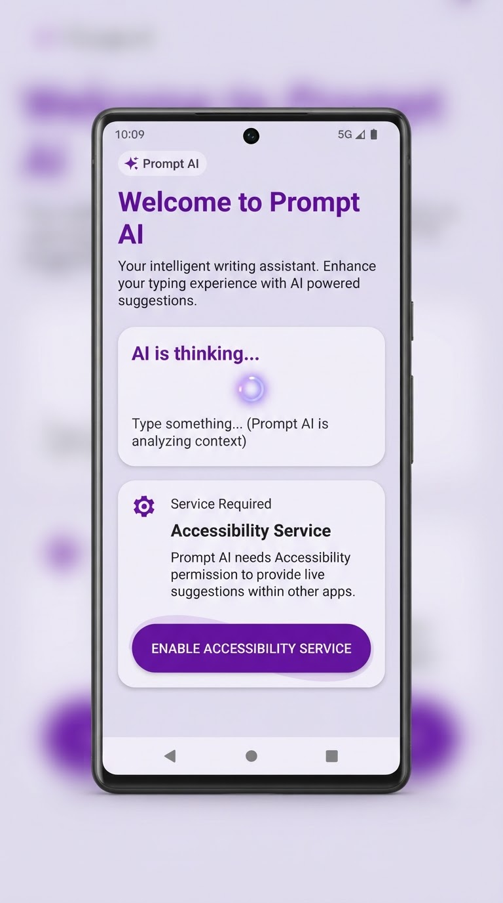
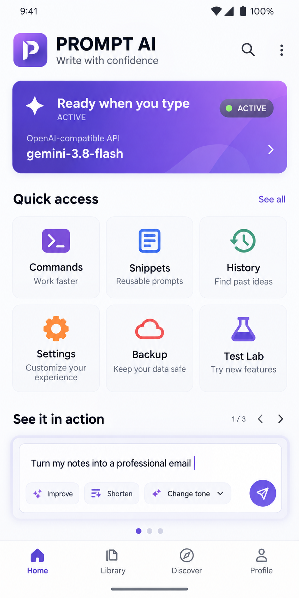
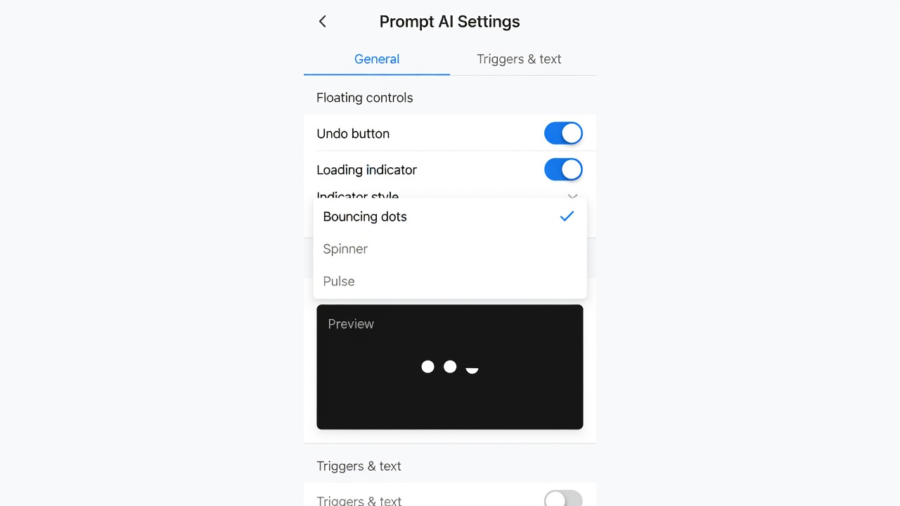

# Prompt AI 🚀 — Fork by Stlucifer15t

<p align="center">
  
</p>

<p align="center">
  <b>AI writing tools and utilities in every Android text field.</b><br/>
  <i>Forked from <a href="https://github.com/estiaksoyeb/TypeAssist">estiaksoyeb/TypeAssist</a> with new features and cleanups.</i>
</p>

<p align="center">
  
  
  
  <a href="https://github.com/Stlucifer15t/TypeAssist/releases"></a>
</p>

> **Acknowledgement:** This repository is a **fork** of [estiaksoyeb/TypeAssist](https://github.com/estiaksoyeb/TypeAssist) (originally Prompt AI / TypeAssist). Original work and core functionality by Estiak Soyeb. This fork keeps the same package ID `com.typeassist.app` for compatibility and builds upon it.

---

## 📥 Download

Grab the latest APK from the **[Releases page](https://github.com/Stlucifer15t/TypeAssist/releases)** and open it with Android's package installer.

*   **Requires Android 7.0 (API 24) or newer.**
*   Builds are for **arm64-v8a** devices (current 64-bit phones and tablets).

> Existing users of an older copy: export a backup first (Home → Backup), then install this build once. Restore your backup afterwards if your settings do not carry over.

---

## 🚀 First-time setup

1.  **Install and open Prompt AI.** The first launch walks you through a short onboarding.
2.  **Read the welcome pages** — a quick preview of how triggers work in any text field — then tap **Next**.
3.  **Enable the Accessibility Service.** Accessibility is the one *required* permission: it lets Prompt AI read the text field you are typing in and replace text with the result. Tap **Accessibility Service**, turn on **Prompt AI Accessibility Service** in Android settings, and come back.
4.  **Grant the recommended permissions** (optional but strongly advised, shown as *Recommended for stability*):
    *   **Notifications** (Android 13+) — keeps the foreground service running.
    *   **Ignore Battery Opt.** — stops Android from killing the app in the background.
    *   **Xiaomi Setup** — on Xiaomi devices, enable *Autostart* and *Pop-up windows*.
5.  **Tap Get Started.** The button unlocks once Accessibility is on. If you skip the recommended items, Prompt AI warns that the service may stop unexpectedly.
6.  **Add an AI provider** (see below) and switch the assistant on from the Home screen.

Later, the same checklist lives in **Settings → Reliability → Permissions & service health**. The ⓘ button on the Home screen shows the quick fix if the service ever seems paused: switch Prompt AI off and on again in Android's Accessibility settings.

---

## 🤖 Provider setup

Open **Settings → Assistant → Provider & model** to choose the service Prompt AI uses for AI commands. Four options are supported, and saving any of the three cloud providers runs **Test connection & save**: a short sample request that reports what went wrong (bad key, wrong URL, missing model, quota, network…) in plain language.

### Google Gemini
1.  Paste your **Gemini API key** (it is masked, with a show/hide toggle).
2.  Tap **Load models** to fetch the text-generation models your key can use, then **search, favourite** and pick from **recents** — or simply type a model ID manually.
3.  Save. Prompt AI remembers this as a **saved Gemini profile** you can re-apply later.

### Cloudflare Workers AI
1.  Enter your **Account ID** and **Workers AI API token**.
2.  Set the **Model ID**, for example `@cf/meta/llama-3-8b-instruct`.
3.  Tap **Test connection & save**; the setup is stored as a **saved Cloudflare profile**.

### OpenAI-compatible API
1.  Enter the **Base URL**, for example `https://api.openai.com/v1`.
2.  Enter an **API key** (optional — some self-hosted endpoints do not need one).
3.  Tap **Load models** to pull IDs from the standard `/models` endpoint, or type the model ID yourself if the provider does not publish one.
4.  Tap **Test connection & save**; it is kept as a **saved API profile**.

### Local LLM (on-device)
Open **Settings → Assistant → Provider & model → Local model** to run models entirely offline with llama.cpp:
1.  **Select Model** and choose a `.gguf` file (for example a Qwen2-0.5B-Instruct GGUF). The file is streamed into the app's private cache; **Clear Model Cache** frees the space again.
2.  Optionally enable **Use GPU Acceleration (Vulkan)** for Mali/Adreno GPUs, and tune **Temperature**, **Top-P**, **Max Tokens** and **Threads**.
3.  Reasoning models (Qwen3, DeepSeek-R1 and similar) are detected automatically; **Disable Reasoning Output** adds a `/no_think` hint and strips `<think>…</think>` blocks from the answer.
4.  Tap **Set as active provider**.

> Local inference is slower and uses more battery than a cloud provider, and very small models can return empty or off-topic answers.

**Active provider at a glance:** the Home screen card shows the current provider and model, and its switch pauses or resumes the assistant. Prompt AI will prompt you for a key if you try to enable it before a provider is configured.

---

## ⌨️ Common shortcuts

Type a shortcut straight into any text field — Prompt AI detects it after a short pause and replaces it with the result.

| Shortcut | What it does | Example |
| :--- | :--- | :--- |
| `.ta` | Ask AI | `Population of Tokyo? .ta` |
| `.g` | Fix grammar, spelling and punctuation | `i go home yestarday .g` |
| `.tr` | Translate to English | `你好世界 .tr` |
| `.polite` / `.casual` | Rewrite the tone | `Give me the money .polite` |
| `.improve` | Improve clarity and flow | `meeting notes attached .improve` |
| `...instruction...` | Rewrite the whole text field | `I am late ...make this polite...` |
| `(%:.ta)` | Inline ask, mid-sentence | `I am visiting (%:.ta: capital of Japan) next week.` |
| `ta#email` | Expand a snippet (prefix configurable) | `ta#email` → `user@example.com` |
| `(.save:name:content)` | Save a snippet instantly | `(.save:addr:123 Main St)` |
| `(.c: 25 * 4 + 10)` | Offline calculator (`+ - * / ^ ( ) sqrt sin cos tan log`) | → `110` |
| `.now` / `.date` | Insert the current time / date | → `2026-10-07 14:30` |
| `.pass` | Generate a strong random password | → `t7#Kq2!mVs9x` |
| `.reply` | Draft a reply to the conversation on screen, copying your own writing style (needs screen context) | `Sounds good, see you then .reply` |
| `.sum` | Summarize what is on screen (needs screen context) | `.sum` |
| `.ta` + `@screen` | Ask a question about what is on screen | `What does this error mean? @screen .ta` |
| `.undo` | Revert the last change | |

By default a trigger must sit at the end of the text. In **Settings → Behaviour → Triggers & text** you can **Allow triggers anywhere**, **Ignore the preceding space** (so `hello.ta` works), and change the **Global rewrite pattern** (`%` marks where the instruction goes, default `...%...`).

Custom commands and inline patterns are created in the **Commands** tab; every command is `%`-based, where `%` is replaced with your text.

**After a command runs**, a small **Accept · Reject · Retry** chip appears in the middle of the screen for a few seconds, where the keyboard is less likely to cover it: Accept keeps the result, Reject puts your original text back (the same thing `.undo` does), and Retry runs the command again. The chip never takes focus from what you are typing, and it disappears as soon as you type or move to another field. Turn it off in **Settings → Behaviour → After a reply**.

**Answers stream in as they are written** with Gemini and OpenAI-compatible providers, so the text appears in the field while the model is still typing; Cloudflare and local models answer in one piece. While a stream is running the chip is a **Stop** button that cancels the request and restores your text. Streaming is on by default and can be turned off in **Settings → Behaviour → After a reply**.

**Connections are kept warm.** Requests share one connection pool, so a second command to the same provider reuses the open connection instead of shaking hands again, and a dropped Wi-Fi-to-mobile handover is retried once automatically (as are 429 and 5xx replies). Retries only ever happen *before* any text has arrived: once the model has started answering, a failure is reported instead of being sent twice.

---

## 🧭 Navigating the app

The bottom bar has five destinations:

*   **Home** — one **switch** for the assistant, one card showing the **active provider and model**, and a prompt to enable Accessibility when it is missing. Quick actions for **Commands**, **Snippets**, **History**, **Command gallery**, **Backup** and **Try a trigger** sit directly under it, followed by example shortcuts and a link to this repository. There is no welcome banner and no activity feed: everything on the screen is something you can act on.
*   **Commands** — your AI shortcuts, split into **Standard** (trailing triggers such as `.sum`) and **Inline** (patterns such as `(%:.ta)`). Search, add, edit and delete commands, or open the **Command gallery** to add ready-made templates (professional email, summarise, action items, and more).
*   **Snippets** — reusable text blocks, opened by typing the snippet prefix plus a name. A snippet can hold several **variations**; when more than one exists, Prompt AI shows a picker before inserting. The prefix and the quick-save pattern are editable in **Settings → Behaviour**.
*   **History** — two tabs. **History** holds the original text of everything Prompt AI processed in the **last hour** (the window is a setting: 5 minutes to 4 hours, or any custom value). Copy an entry back to the clipboard, or clear the list. **Usage** shows requests and tokens per provider, for this session and in total. Turn retention off in Settings if you prefer.
*   **Settings** — grouped by topic rather than by tab:
    *   **Assistant** — **Provider & model** (the provider setup described above, plus **Local model**), **Behaviour** (replies, triggers, history, timeouts, screen context and the drafted-reply tone and length), **Text generation** (temperature, top-p and the answer-length limit, with presets) and **Appearance** (theme, floating controls, indicator style, colour and size).
    *   **Reliability** — **Permissions & service health**, with the live status of the accessibility service and every optional setting that keeps it running.
    *   **Data** — **Token usage** (requests and tokens per provider) and **Backup & restore**, including the advanced raw-JSON editor.
    *   **Learn & about** — **User guide** (generated from your own commands, so it always matches this device), **Tips & examples**, the version and update check, an **Interface preview** of the floating surfaces, and the source link.

Back returns to the screen a detour was started from: from **Provider & model** it goes back to Settings, from Settings it goes to Home.

---

## 🎨 Themes and indicators

**Appearance** (Settings → Appearance) offers four Material 3 themes. Each choice shows a small colour preview.

*   **System** — follow the device setting.
*   **Light** — warm off-white background with white surfaces.
*   **Dark** — deep charcoal background with raised surfaces.
*   **AMOLED black** — true-black background with near-black cards, which saves power on OLED screens.

All three share one accent colour: a single **electric-lime** family, brightened for the dark appearances and deepened for the light one, so the app reads as one product in every mode. Type is set in **Nunito** throughout.

The floating chip, preview card and snippet picker use the theme you pick here. With **System**, they follow the device setting.

The installed version shows a short **release announcement once**, on the first launch after an update.

**Floating controls** control the small overlays that appear while Prompt AI works:

*   **Undo button** — a quick revert action after text is replaced.
*   **Loading indicator** — the progress overlay while the AI responds, in seven styles with a live preview in Settings: **Classic**, **Bouncing dots**, **Pulse**, **Bars**, **Typing**, **Pill** and **Neon ring**.
*   **Indicator colour** — quick-swatch presets, a hex field for any `#RRGGBB` colour, and a hue/saturation/brightness mixer. Chosen colours are kept opaque. The neon ring uses its own locked animated spectrum (electric blue/cyan/violet/magenta/pink) and is not recoloured.
*   **Indicator size** — 50 %–200 %; 100 % is the original size and every style scales.

**Other options in Settings → Behaviour:** **Save processed text to history** with its **Keep for** window (5 minutes, 30 minutes, 1 hour, 4 hours or a custom number of minutes), **Preview longer responses** (responses over 15 words are shown for review before insertion), the **Replies** settings (accept/reject chip, streaming), the **Drafted replies** section (**tone** — match me, warm, formal, direct — and **length** — short, medium, detailed — both sent with `.reply`), the **Screen context** section (opt-in screen reading with its app blocklist), a **Network timeout** of 10–120 seconds, and an **App updates** card with your version and a manual **Check** button.

**Settings → Text generation** holds the sampling values sent to every provider: a **Precise / Balanced / Creative** starting point, then **Temperature** (0–2), **top-p** (0.05–1.0) and a **Max tokens** limit (0 means "let the provider decide"). The card at the bottom shows exactly which fields are sent, and Gemini, OpenAI-compatible endpoints and Cloudflare Workers AI all receive them.

---

## 🔒 Privacy

*   **No middleman.** Prompt AI has no proxy server; requests go straight from your device to the provider you configured.
*   **On demand.** The Accessibility Service watches editable-field text only to find commands. Text is sent to an AI provider **only when you invoke an AI command** — nothing is sent while you type normally.
*   **Nothing runs when paused.** The assistant switch on the Home screen disables processing entirely.
*   **Screen context is opt-in.** `.reply`, `.sum` and `.ta` with `@screen` send the visible text of the current screen to your AI provider — and only those commands do. Screen reading is off until you enable it in **Settings → Behaviour → Screen context**, never happens in the background, and is skipped entirely in the apps on your blocklist (banking, payment and password-manager packages are preloaded). For `.reply`, messages on the right side of the screen count as yours (marked `Me:`), and the reply copies your style from them.
*   **Local storage.** API keys and settings live in the app's private preferences. Saved profile rows mask keys, and the raw-JSON editor warns that it contains them.
*   **Short-lived history.** Processed text is kept in memory for one hour by default (the window is yours to change, between 5 minutes and 24 hours), never written to storage, and can be cleared at any time.
*   **Token counting is just counting.** The Usage tab stores only numbers — how many requests and tokens per provider and model. No text from any conversation, and nothing about the app it was typed into, is kept.
*   **Crash reports stay on the device.** If the app closes unexpectedly, the technical reason and your device model are written to the app's private files — never your text — and shown on Home the next time you open the app, with a button that copies the details.
*   **Offline option.** With the Local LLM provider, your text never leaves the device.
*   **Only the permissions it needs.** Internet access for AI requests, network state (read-only, used to tell "no connection" apart from a provider error), an overlay (system alert window) for the indicator and undo button, notifications and battery-optimization access so the service survives in the background.

### 📜 Provider policies
*   **Google Gemini:** [API Terms of Service](https://ai.google.dev/gemini-api/terms)
*   **Cloudflare Workers AI:** [Data Usage & Privacy](https://developers.cloudflare.com/workers-ai/platform/data-usage/)

Custom and OpenAI-compatible endpoints are your responsibility: check the privacy policy of whichever service you point Prompt AI at.

---

## 💾 Backups

Open **Home → Backup** (Backup & Restore) to export or restore everything: settings, provider profiles and keys, commands and snippets.

*   **Backup to File** writes a single `.tabak` file that you choose the location for. Add a password in the dialog to encrypt it.
*   **Encryption:** password-protected backups use AES-256-GCM with a PBKDF2-HMAC-SHA-256 key (65 536 iterations) and are gzip-compressed. Leave the password empty for a plain, unencrypted file.
*   **Restore from File** accepts a `.tabak` backup and replaces the current configuration. Encrypted files ask for the password first; a wrong password or corrupted file is reported instead of silently failing.
*   **Advanced: Raw JSON** shows the full configuration for power users and manual edits, with a **Copy JSON** / **Apply JSON** pair. This view contains API keys, so edit it carefully.

---

## 🛠 Building from source

**Requirements**

| Tool | Version |
| :--- | :--- |
| JDK | 17 (source/target compatibility is Java 17) |
| Android SDK | Platform 35 (`compileSdk`/`targetSdk` 35) |
| Android NDK | 27.0.12077973 |
| CMake | 3.22.1 |
| Gradle | 9.0.0 (via the bundled wrapper) |
| Kotlin / AGP | 2.1.0 / 8.13.0 |

The native local-LLM engine is a **git submodule** (`llama.cpp`), so clone recursively:

```bash
git clone --recurse-submodules https://github.com/Stlucifer15t/TypeAssist.git
cd TypeAssist
./gradlew assembleFullDebug        # debug build
./gradlew test                     # JVM unit tests
```

Notes:

*   Only the **arm64-v8a** ABI is built.
*   Two product flavors exist: `full` (in-app update checks) and `fdroid` (update checks disabled).
*   Pushes to `master` (and `arena/*` branches) plus every pull request run the GitHub Actions build workflow, and the build log is uploaded for each run.
*   Release APKs are produced and published by the tag-triggered release workflow on the [Releases page](https://github.com/Stlucifer15t/TypeAssist/releases).
*   `minSdk` is 24, so the app runs on Android 7.0 and above.

---

## 📸 Screenshots

  <div align="center">
    
    
    
  </div>

---

## 🧱 Tech stack

*   **UI:** Jetpack Compose (Material 3) on a small in-house design system (`ui/Theme.kt`, `ui/ThemePalettes.kt`, `ui/components/`), Compose Markdown for release notes
*   **Type:** Nunito, bundled as four static instances (SIL Open Font License, see `app/src/main/assets/licenses/`)
*   **Language:** Kotlin 2.1.0
*   **Network:** OkHttp, Retrofit / Gson
*   **Service:** Android `AccessibilityService` with a foreground notification and window overlays
*   **On-device AI:** llama.cpp via NDK/CMake (GGUF models, optional Vulkan acceleration)
*   **Architecture:** MVVM-style Compose screens over a shared `AppConfig`

---

## 🙏 Credits

- **Original author:** [estiaksoyeb](https://github.com/estiaksoyeb) — [TypeAssist](https://github.com/estiaksoyeb/TypeAssist)
- **Fork maintainer:** [Stlucifer15t](https://github.com/Stlucifer15t)

---

## 📜 License

Distributed under the **GPLv3 License**. See [`LICENSE`](LICENSE) for the full text. The original license is retained from upstream.
